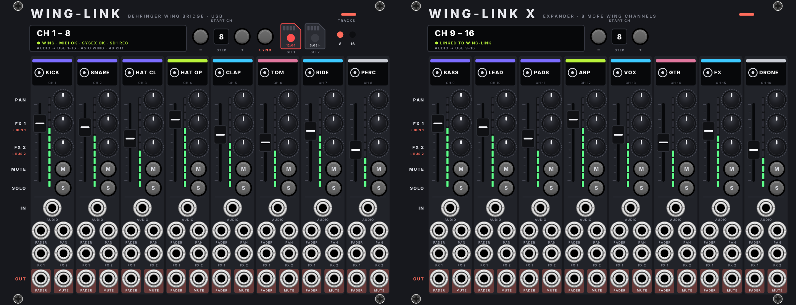
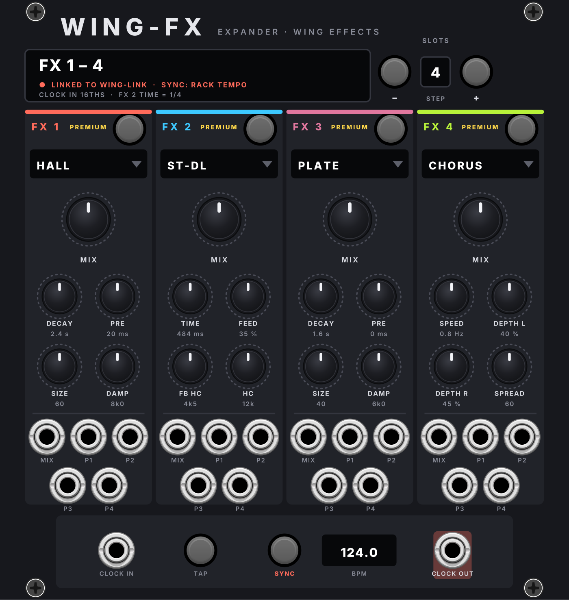
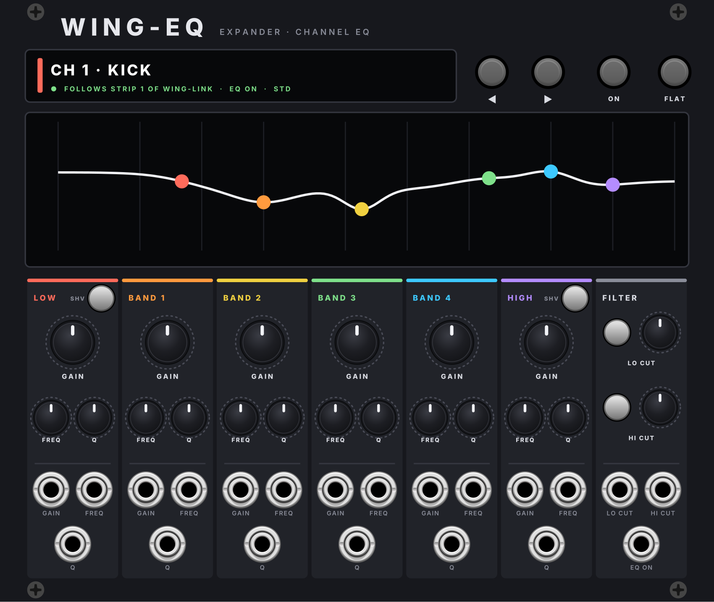

# WING-LINK für VCV Rack

Eine Brücke von VCV Rack zum Behringer **WING** (gebaut und getestet für die WING COMPACT) über **ein USB-Kabel**,
im Look des GENRA-Plugins. Plugin-Version **2.4.1**, 4 Module (WING-LINK, WING-LINK X, WING-FX, WING-EQ).

- **WING-LINK**: 8 Spuren. **WING-LINK X**: 8 Spuren mehr. **WING-FX**: die 16 Effekte der WING. **WING-EQ**: EQ und
  Filter eines Kanals.
- WING-LINK X, WING-FX und WING-EQ verbinden sich **von selbst**, wenn es nur ein WING-LINK im Patch gibt. Sonst per
  Rechtsklick › *Connect to WING-LINK*, oder angedockt (X rechts neben WING-LINK, FX links daneben).
- **Audio**: Was in die AUDIO-Buchsen geht, landet direkt auf den USB-Eingängen der WING. WING-LINK ist dafür
  selbst ein Audio-Ausgang (wie Racks Audio-Modul), ein Audio-16-Modul braucht es nicht.
- **Steuerung** über USB-MIDI, in beide Richtungen: Fader, Pan, Mute, Solo und zwei Sends (FX 1 / FX 2 auf frei
  wählbare Busse).
- **Name, Farbe und Icon** jeder Spur stellt man auf dem Panel ein, sie gehen sofort an den WING-Kanal.
- **CV**: Fader, Pan und Sends per CV fahren (die Fader bewegen sich mit, auch an der WING). Ausgänge: Fader als
  0–10 V und Mute als Gate.

## Installation unter Windows

**Fertige Version (empfohlen):** Unter [**Releases**](https://github.com/Camillowup/Wing-link-for-vcv-rack/releases)
die neueste `WingLink-2.x.x-win-x64.vcvplugin` herunterladen.

1. Die Datei nach `%LOCALAPPDATA%\Rack2\plugins-win-x64\` kopieren (in Rack: *Help › Open user folder*, dort
   `plugins-win-x64`). Eine ältere `WingLink-…vcvplugin`-Datei und den Ordner `WingLink` dort vorher löschen.
2. Rack neu starten.

**Testversion aus der Entwicklung:** Jeder Push baut automatisch. Unter **Actions** den grünen Lauf öffnen → unten
bei **Artifacts** `winglink-windows` laden → Zip entpacken → wie oben installieren. Diese Builds löscht GitHub nach 90 Tagen;
Releases bleiben.

## Einrichten (einmal)

1. **Treiber**: Den Windows-ASIO-Treiber der WING von behringer.com installieren, PC neu starten.
2. **WING per USB** an den PC.
3. **An der WING**:
   - *Setup › USB-Audio*: **48 Kanäle** (WING-LINK schickt standardmässig Spur 1 → USB 1 usw.).
   - *Setup › Remote › MIDI Remote Control*: für **USB** die Kanal-Steuerung (Fader/Mute/Pan) und **SYSEX**
     erlauben. Ohne Sysex gehen nur Fader, Mute und Pan (gröber), Namen/Farben/Icons/Solo/Sends nicht.
4. **In Rack**: *Engine › Sample rate* auf **48 kHz**. WING-LINK ins Rack ziehen: Es sucht die WING selbst
   (MIDI und Audio, ASIO zuerst). Das Display zeigt, ob alles verbunden ist.
5. Mit START CH auf die Kanäle gehen, auf denen der Ton aus Rack landen soll, dann **SYNC** drücken: WING-LINK
   stellt die Quelle dieser Kanäle auf die passenden USB-Eingänge und schickt Namen, Farben und Icons.
   Ist das Routing am Pult schon passend (Snapshot, früheres SYNC), übernimmt ein neues WING-LINK es von selbst –
   kein SYNC nötig. Passt es nicht, steht im Display gelb **WING ROUTING ≠ RACK · PRESS SYNC**.

## In Ableton Live (Rack Pro als Plugin)

- Ableton bekommt das Audio-Interface (WING-ASIO). In WING-LINK beim Audio den Treiber **DAW** wählen: die Spuren gehen
  auf die Plugin-Ausgänge 1–16 (Display: *AUDIO → DAW 1–16 (to WING USB …)*). In Ableton jeden Ausgang n auf den
  WING-Ausgang n routen (Audiospur: *Audio From* = Rack-Spur, Kanal 3/4 …; *Audio To* = Ext. Out).
- MIDI öffnet WING-LINK weiter direkt: in Ableton bei den WING-MIDI-Ports Track/Sync/Remote ausschalten (Windows
  lässt einen MIDI-Port nur von einem Programm öffnen). Ableton gibt SysEx nicht an Plugins weiter – der DAW-MIDI-Treiber
  geht deshalb nicht.

## Bedienung

- **Spur frei belegen**: Rechtsklick auf das Display einer Spur › *WING channel*: *Auto* (folgt START CH) oder fest
  ein Kanal, Aux, Bus, Main, Matrix oder DCA. Feste Spuren bleiben stehen, wenn START CH wandert (• im Display).
  Auf Bus, Main und Matrix sind FX 1 / FX 2 grau, auf DCA auch PAN und SOLO; AUDIO wirkt nur auf Kanäle und Aux.
- **SD-Recorder** (WING-LIVE-Karte): die beiden Karten oben antippen startet bzw. stoppt die Aufnahme auf SD 1 oder
  SD 2, getrennt. Rot = Aufnahme mit laufender Zeit, sonst die freie Zeit. **TRACKS 8 / 16**: so viele Spuren nimmt
  die WING beim Start auf.
- **STEP** neben START CH: − / + springen um 8 (Standard) oder um 1 Kanal (antippen oder Rechtsklick).

- **START CH − / +** blättert die **Ansicht**: welche WING-Kanäle die Fader, Regler und Displays zeigen (CH 41–48 sind
  an der WING die AUX-Kanäle 1–8). Der Ton der AUDIO-Buchsen bleibt dabei, wo er ist: **SYNC** legt ihn fest (ab dem
  Kanal, auf dem START CH beim Drücken steht). WING-LINK X hat ein eigenes START CH (folgt sonst WING-LINK + 8).
- **Namen, Farben, Icons gehören zum WING-Kanal** und gehen in beide Richtungen: am Pult benannt erscheint es in Rack,
  in Rack benannt (Enter oder kurz warten) geht es ans Pult. Ist der Kanal am Pult mit seiner Quelle verknüpft
  (Standard), zeigt die WING Name/Farbe/Icon der Quelle (z. B. USB 1) – dann liest und schreibt WING-LINK dort.
- Lehnt die WING etwas ab, steht ihre Meldung kurz im Display (und im Rechtsklick-Menü).
- **Farbbalken** einer Spur anklicken: nächste Farbe. **Icon** (groß links neben dem Namen) anklicken: nächste Icon-Gruppe. Rechtsklick auf die
  Spur: alle Farben und Icons. **Name**: direkt hineinklicken und tippen (max. 16 Zeichen, ohne Umlaute).
- **SYNC**: schickt Namen, Farben, Icons und das USB-Routing an die WING und liest danach Fader, Pan, Mute, Solo
  und Sends von der WING zurück.
- Beim Verbinden übernimmt WING-LINK die Stellungen der WING (die WING gilt).
- Rechtsklick aufs Modul: Audio-Gerät, USB-Kanäle, MIDI-Ports von Hand, Busse für FX 1 / FX 2, alles neu lesen.

## WING-FX

- Unter dem Effektnamen eine **kleine Grafik**, live aus den Reglern: Hallfahne, Echos, LFO, EQ-Kurve, Kennlinie …
- Zeigt 4 FX-Plätze, **SLOTS − / +** blättert durch FX 1–16, um 1 oder 4 Plätze (**STEP**, antippen).
- Rechtsklick auf einen der vier Parameter-Regler: welchen Parameter des Effekts er dreht (pro Effekt gespeichert).
- **Effekt wählen**: aufs Modell klicken › *PREMIUM* (Hall, Delay, Modulation, Pitch – nur auf FX 1–8) oder
  *STANDARD* (EQ, Dynamik, Amps …).
- **ON**, **MIX** und vier Parameter je Effekt (die Namen wechseln mit dem Effekt), alles in beide Richtungen und
  per CV (0–10 V).
- **Tempo**: *SYNC an*: die Delays übernehmen Racks Tempo (CLOCK IN oder TAP). *SYNC aus*: das Tempo kommt von der
  WING (dort tappen), CLOCK OUT gibt es an Rack weiter. Auflösung von CLOCK IN / OUT per Rechtsklick (Standard 16tel).
- An der WING zusätzlich unter *Setup › Remote › MIDI Remote Control* die **FX-Steuerung** für USB erlauben.

## WING-EQ

- Der **Standard-EQ (STD)** eines WING-Kanals: LOW, BAND 1–4, HIGH mit GAIN, FREQ und Q, LOW und HIGH als Shelf
  oder Peak (**SHV**), dazu **LO CUT** und **HI CUT** des Kanals. Alles in beide Richtungen.
- Oben die **Kurve**, gerechnet aus den Reglern; jedes Band als farbiger Punkt.
- **Kanal**: ◀ ▶ blättert durch CH 1–40 und AUX 1–8. Klick aufs Display: einer Spur von WING-LINK folgen, dem an der
  WING mit **SELECT** gewählten Kanal folgen, oder einen Kanal fest wählen.
- **ON** schaltet den EQ, **FLAT** setzt alle Gains auf 0 dB.
- **CV**: GAIN ±5 V = ±15 dB, FREQ / Q / LO CUT / HI CUT 0–10 V, EQ ON als Gate.
- Hat der Kanal an der WING ein anderes EQ-Modell (SOUL, E88 …), zeigt das Display eine Warnung: WING-EQ steuert nur
  den STD-EQ.

## Gut zu wissen

- Verbundene Displays leuchten grün (WING-LINK X, WING-FX, WING-EQ am WING-LINK); unter dem Effekt-Modell zeigt
  WING-FX ein Bild der Effektart.

- Läuft schon ein Audio-Modul von Rack auf der WING (z. B. zum Abhören auf USB 1–2), stört das nicht, solange es
  andere USB-Kanäle benutzt als WING-LINK.
- Ändert man an der WING die USB-Kanalzahl oder die Samplerate, trennt sich USB kurz; WING-LINK verbindet sich
  von selbst wieder.
- Noch nicht an der echten WING geprüft: die Reihenfolge der Farben, Solo per Fernsteuerung, der Name des
  MIDI-Ports der WING COMPACT, ON der Effekte (läuft über den Insert-Schalter der WING). Rückmeldungen dazu bitte in die Issues.

## Bauen

Über GitHub Actions (Windows), siehe `.github/workflows/main.yml`. Neue Version veröffentlichen: Versionsnummer in
`plugin.json` erhöhen, testen, `main` auf den Branch `release` pushen; der Workflow legt den Tag `v<Version>` an und
veröffentlicht den Release mit der `.vcvplugin`-Datei. Panels: `tools/winglink_panel.py real` und
`tools/wingfx_panel.py real` (schreiben `res/*.svg` und die Layout-Header), Vorschau mit `preview OUT.png RACK`.
Die Effekt-Liste: `tools/fx_models.py` schreibt `src/WingFxModels.hpp` aus `tools/data/wing_fx_params.json`.

Lizenz: GPL-3.0. Protokoll nach Patrick-Gilles Maillots „WING Remote Protocols“.
